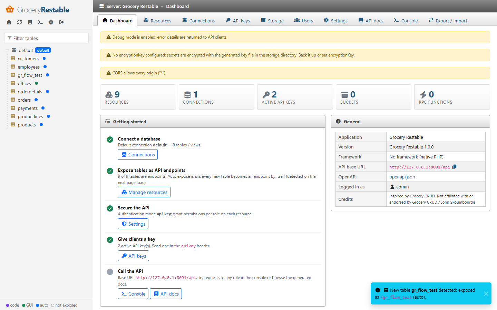

# Grocery Restable

**Turn any MySQL / MariaDB, PostgreSQL or SQLite database into a secure REST API in minutes** — the
[PostgREST](https://postgrest.org) / [Supabase](https://supabase.com) way, configured the
[Grocery CRUD](https://github.com/scoumbourdis/grocery-crud) way, managed from a phpMyAdmin-style GUI.

> **Inspired by Grocery CRUD. Not affiliated with or endorsed by Grocery CRUD / John Skoumbourdis.**



```php
// CodeIgniter 4 — app/Config/GroceryRestable.php
public function define(\GroceryRestable\GroceryRestable $api): void
{
    $api->resource('employees')
        ->setSubject('Employee')
        ->setRelation('officeCode', 'offices', '{city} ({country})')
        ->setRelationNtoN('projects', 'employee_project', 'projects', 'employee_id', 'project_id', 'name')
        ->requiredFields('lastName', 'email')
        ->setRules('email', 'required|valid_email')
        ->setFieldUpload('photo', 'employees', 'jpg|png');
}
```

```http
GET /api/employees?select=lastName,offices(city),projects(name)&officeCode=eq.4&order=lastName.desc&limit=10
POST /api/employees            (JSON, multipart with files, or an array for bulk insert)
PATCH /api/employees/1002
POST /api/employees/1002/upload/photo
GET /api/storage/avatars/users/42/me.png
```

## Features

- **Instant REST API** for tables and views: list, read, create (single / bulk / upsert), update, replace,
  bulk update, delete, bulk delete, clone, CSV export.
- **PostgREST-compatible querying**: `select` projection with aliases, resource **embedding** (joins) up to
  N levels, filters (`eq`, `neq`, `gt`, `gte`, `lt`, `lte`, `like`, `ilike`, `in`, `is`, `not.`), nested
  `or` / `and` groups, filters on related tables, ordering with `nullsfirst/last`, paging, exact counts
  (`Content-Range`), full-text style search.
- **Relations** like Grocery CRUD: `belongs_to` (`set_relation`), `many_to_many` (`set_relation_n_n`, with
  priority and writes) and `has_many` — defined in code, in the GUI, or **detected automatically** from
  foreign keys.
- **Three ways to define resources** — code (fluent, Grocery CRUD compatible incl. snake_case aliases),
  GUI (stored in SQLite) or **auto expose** (generated from the schema). Precedence: code > GUI > auto.
- **Uploads & storage**: field uploads (`set_field_upload`), multipart create/update, file download, and
  Supabase-style **storage buckets** — with extension allow-lists, MIME sniffing and path traversal protection.
- **Security**: API keys (`anon` / `service_role` like Supabase), JWT (HS256/384/512), per-role permissions,
  **row-level security** with `scope()`, CORS, CSRF-protected admin, encrypted secrets at rest, parameterized SQL only.
- **Validation** with CodeIgniter rule strings (`required|valid_email|max_length[50]`), unique fields, typed
  input checks, password hashing field type.
- **Callbacks** (`callback_before_insert`, `callback_after_update`, `callback_column`, `callback_upload`, …),
  custom **actions** per record and **RPC** functions.
- **OpenAPI 3.1** document at `/api/openapi.json` + field metadata at `/api/_schema`.
- **Admin GUI** (jQuery + Bootstrap 5 + Font Awesome from CDN, no build step): setup wizard, table browser and
  row editor, resource / relation / permission editors, API keys, storage browser, settings, API docs, console.
- **All GUI configuration is stored in SQLite.**
- **Framework support**: **CodeIgniter 4** (auto-discovered routes, services, spark commands, database groups,
  validation, sessions) and **no framework** (native PHP front controller).
- **Database engines & drivers**: MySQL / MariaDB (PDO or MySQLi), PostgreSQL (PDO), SQLite (PDO); in CodeIgniter
  you can also reuse CI's own MySQLi / Postgre / SQLite3 connections.

## Requirements

- PHP 8.2+ with `pdo`, `pdo_sqlite` (configuration store), `sodium`, `fileinfo`, `json`
- A driver for your database: `pdo_mysql` or `mysqli`, `pdo_pgsql`, `pdo_sqlite`
- CodeIgniter 4.5+ for the CodeIgniter integration (tested with 4.7)

## Quick start (CodeIgniter 4)

```bash
composer require kctofficial/grocery-restable
php spark grocery-restable:publish          # optional: app/Config/GroceryRestable.php
php spark serve
```

Open `http://localhost:8080/grocery-restable` and follow the setup wizard (or run `php spark grocery-restable:setup`).
Then call the API:

```bash
curl "http://localhost:8080/api/employees?select=*&limit=5" -H "apikey: <service_role key>"
```

See **[CodeIgniter 4](docs/src/content/docs/codeigniter4.md)**. Without a framework: **[No framework](docs/src/content/docs/no-framework.md)**.

## Documentation

📖 **Documentation website:** <https://kctofficial.github.io/grocery-api/> (built from [`docs/`](docs) with
[Astro Starlight](https://starlight.astro.build) and published by GitHub Actions). The Markdown sources can also be
read directly on GitHub:

| Topic | |
|---|---|
| [Getting started](docs/src/content/docs/getting-started.md) | Concepts and a 10-minute tutorial |
| [CodeIgniter 4](docs/src/content/docs/codeigniter4.md) | Installation, config, routes, filters, commands |
| [No framework](docs/src/content/docs/no-framework.md) | Plain PHP front controller |
| [Database connections](docs/src/content/docs/database-connections.md) | Engines, PHP drivers (PDO / MySQLi), CodeIgniter groups |
| [Configuration](docs/src/content/docs/configuration.md) | Bootstrap options and runtime settings |
| [Admin GUI](docs/src/content/docs/admin-gui.md) | Setup wizard and every screen |
| [Resources](docs/src/content/docs/resources.md) | Defining resources: full method reference |
| [Relations](docs/src/content/docs/relations.md) | belongs_to, has_many, many_to_many, embedding |
| [REST API reference](docs/src/content/docs/rest-api.md) | Endpoints, query syntax, responses, errors |
| [Uploads & storage](docs/src/content/docs/uploads-and-storage.md) | Field uploads and buckets |
| [Authentication & permissions](docs/src/content/docs/authentication.md) | API keys, JWT, roles, row-level security |
| [Validation](docs/src/content/docs/validation.md) | Rules, unique, types |
| [Callbacks, actions & RPC](docs/src/content/docs/callbacks-actions-rpc.md) | Hooks and custom endpoints |
| [OpenAPI](docs/src/content/docs/openapi.md) | openapi.json and `_schema` |
| [Security](docs/src/content/docs/security.md) | Threat model and hardening checklist |
| [Architecture](docs/src/content/docs/architecture.md) | Internals and extension points |
| [Migrating from Grocery CRUD](docs/src/content/docs/migrating-from-grocery-crud.md) | Method mapping |
| [Troubleshooting](docs/src/content/docs/troubleshooting.md) | FAQ |

## Development

```bash
composer install
composer test                                   # PHPUnit (SQLite)
GROCERY_RESTABLE_TEST_MYSQL=mysql://root:@127.0.0.1:3306/grocery_restable_test composer test   # + MySQL (PDO and MySQLi)
php -S 127.0.0.1:8080 examples/standalone/index.php   # try the GUI without a framework

cd docs && npm install && npm run dev                 # documentation website on http://localhost:4321
```

The documentation examples use the MySQL **classicmodels** sample database from
[mysqltutorial.org](https://www.mysqltutorial.org/getting-started-with-mysql/mysql-sample-database/).

## Acknowledgements

Grocery Restable is inspired by [Grocery CRUD](https://github.com/scoumbourdis/grocery-crud) by John Skoumbourdis:
its fluent API style (`set_relation()`, `required_fields()`, callbacks …) is reproduced for familiarity.
**Inspired by Grocery CRUD. Not affiliated with or endorsed by Grocery CRUD / John Skoumbourdis.**

This repository was originally forked from Grocery CRUD. The current code base is a complete rewrite and contains
no Grocery CRUD code; the original Grocery CRUD sources and their license files (MIT / GPL v3,
© John Skoumbourdis) remain only in the git history before this rewrite. "Grocery CRUD" is the name of its
respective owner and is used here only to describe the inspiration and API compatibility.

## License

[MIT](LICENSE) © KCT
