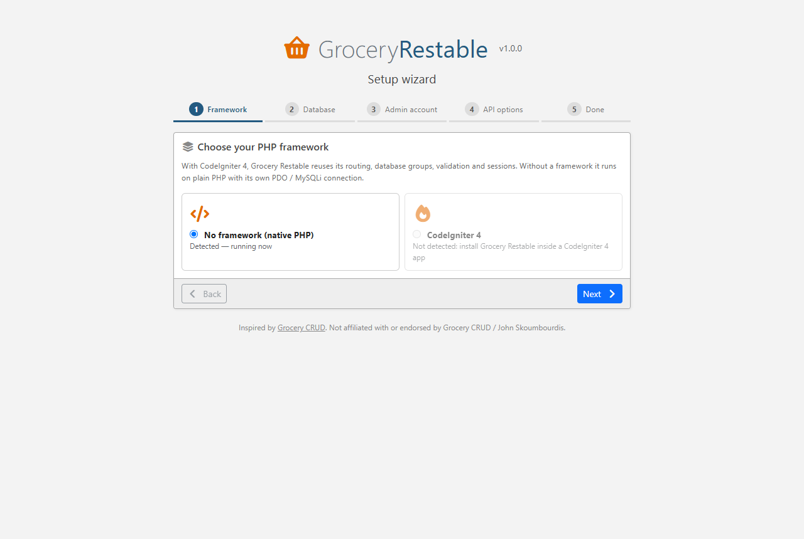
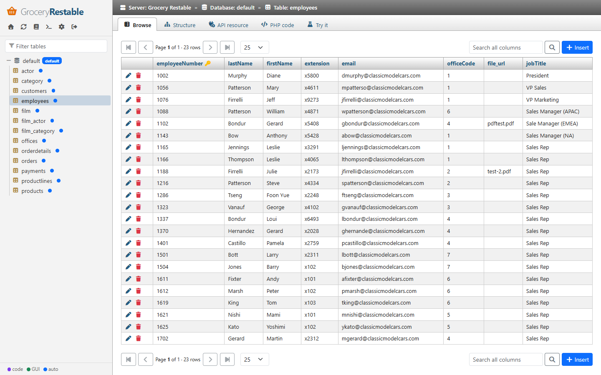
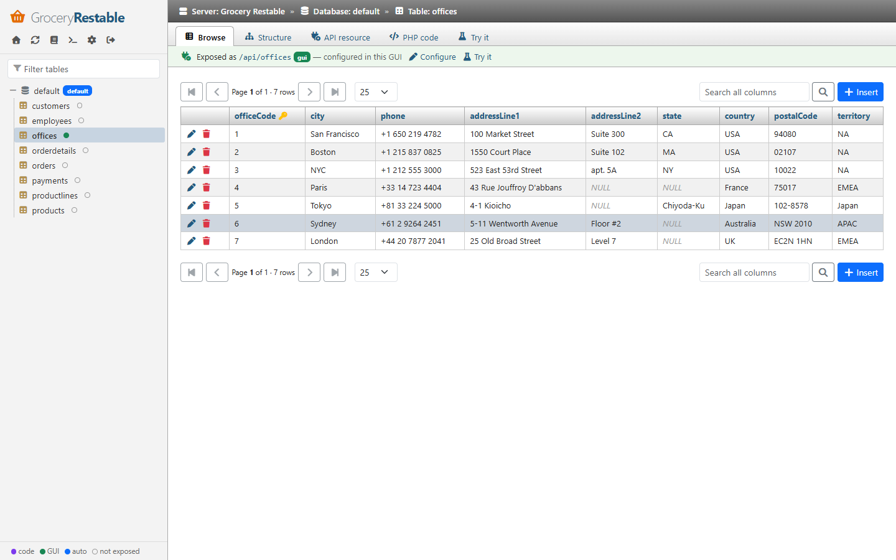
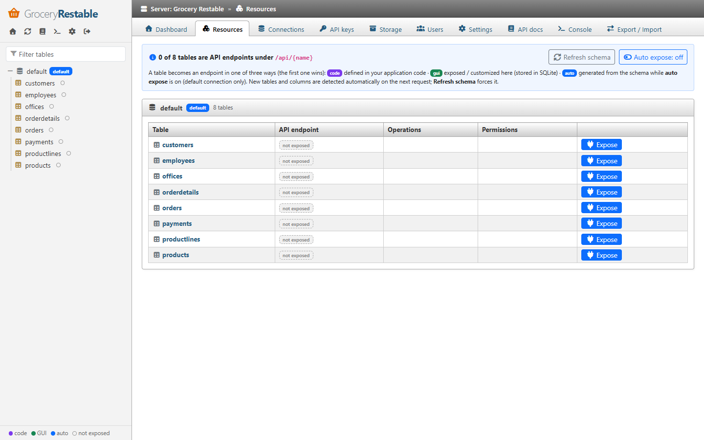
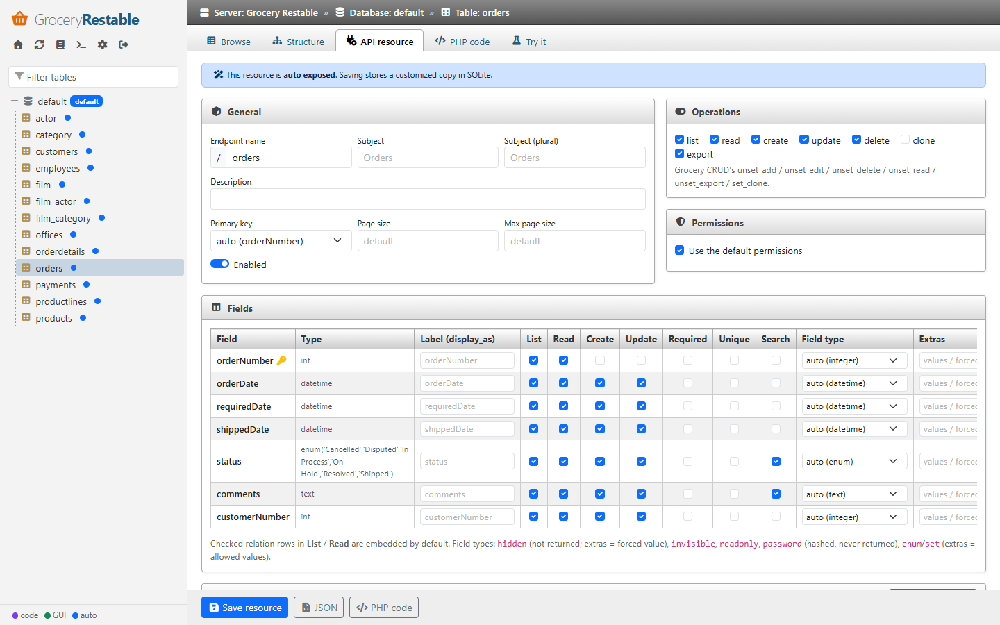
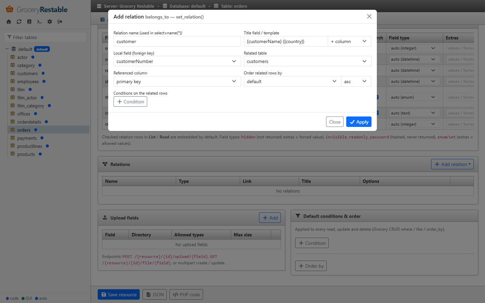
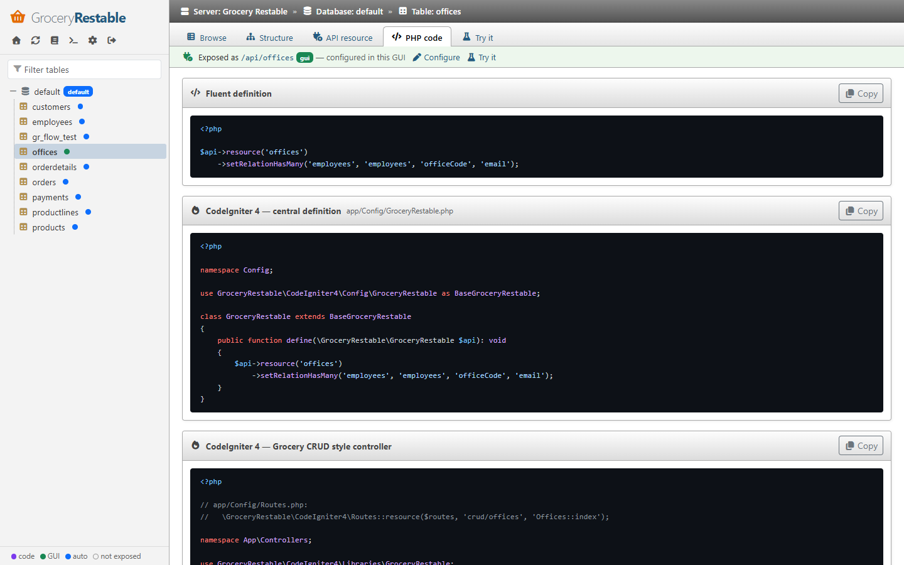
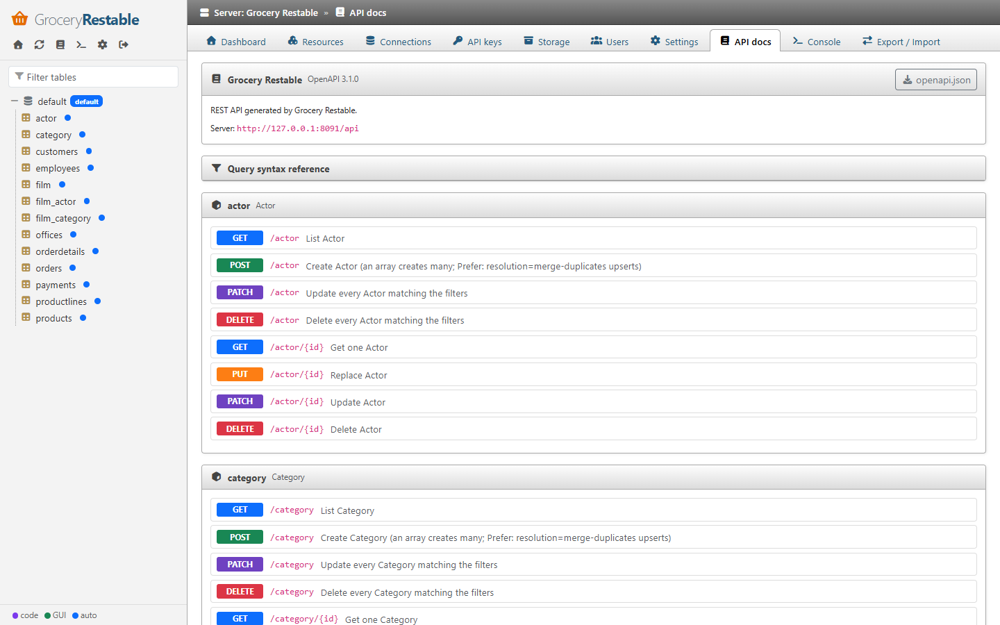
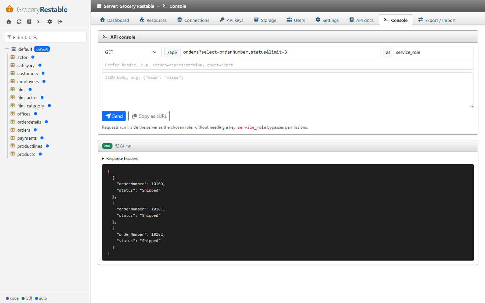
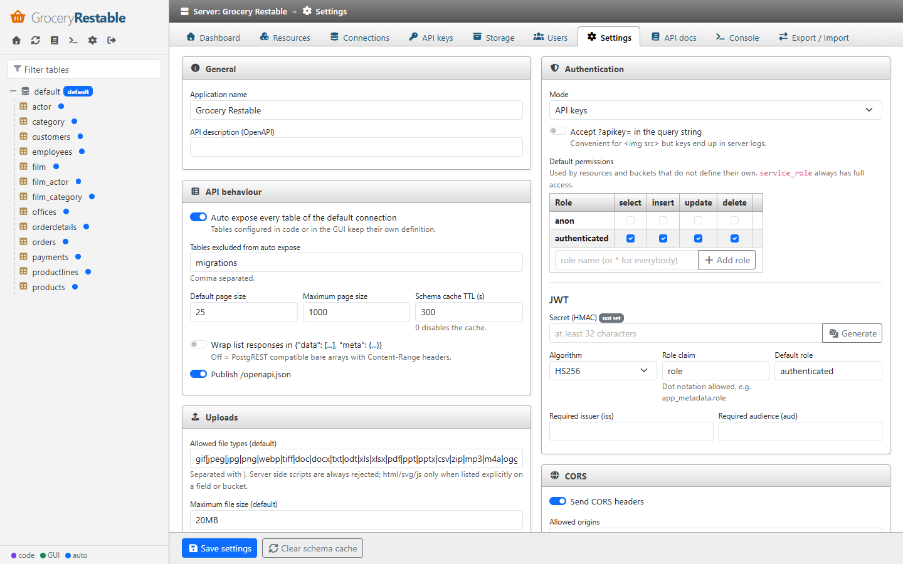

The admin GUI is a single page application built with **jQuery 4**, **Bootstrap 5.3**, **Font Awesome 7** and
**highlight.js 11** loaded from the jsDelivr CDN (with Subresource Integrity), plus a few files served by the library
itself - no build step, no `node_modules`. The look follows phpMyAdmin (navigation tree, breadcrumb bar, tab strip,
framed panels, striped data grids); the flow follows [PocketBase](https://pocketbase.io): a section rail on the left,
a sidebar that belongs to the current section, records and settings edited in side drawers, and a warning before
leaving a page with unsaved changes.

**Offline use:** identical copies of the libraries (same SRI hashes) ship in `src/Admin/assets/vendor`. The CDN is
always tried first; when it is unreachable, `assets/loader.js` detects the missing libraries and loads the local
copies, so the GUI also works without Internet access.

## How a table becomes an API endpoint

1. The database is connected (setup wizard or **Connections**).
2. Each table is either **not exposed**, or exposed by one of three sources - the first one wins:
   **code** (your application) › **GUI** (exposed / customized here, stored in SQLite) › **auto** (generated from the
   schema while *auto expose* is on).
3. With *auto expose* **on**, every table of the default connection is an endpoint, including tables created later.
   With it **off**, click **Expose** in **API › All tables**, **API › New**, or on the status bar of a table in **Data**.
4. Structure changes (new tables, columns, keys) are detected automatically on the next request; the navigation
   re-reads the table list while you move around and a notification announces new tables. The refresh icon in the
   **Data** sidebar (or *Refresh schema* in **API › All tables**) forces it.

The **Overview** shows these steps as a checklist, and every table in **Data** shows a status bar with its endpoint.

Default URL: `/grocery-restable` (`adminRoute` / `adminUrl`).

## Setup wizard

Shown until the first setup is completed, then permanently closed (`404`).

| Step | Content |
|---|---|
| 1. Framework | **No framework (native PHP)** or **CodeIgniter 4**. CodeIgniter is selectable only when the library runs inside a CodeIgniter app. |
| 2. Database | With CodeIgniter: use a CodeIgniter database group, or configure a connection. Otherwise: **database engine** + **PHP driver** (PDO / MySQLi), host, port, database, credentials. *Test connection* runs `SELECT 1`. |
| 3. Admin account | Username (3–64 chars) and password (8+ chars), stored with `password_hash()`. |
| 4. API options | Application name, authentication mode, auto expose. |
| 5. Done | The generated `anon` and `service_role` API keys, shown **once**. |

 

Everything is written in one SQLite transaction, so a failed attempt can simply be retried.

Access to the wizard: only from `trustedSetupIps` (localhost) unless `setupToken` is configured, in which case
open `/grocery-restable/setup?token=<setupToken>`. On servers, prefer `php spark grocery-restable:setup`.

## Login

Username / password form with CSRF protection. After **5 failed attempts per IP within 15 minutes** further
attempts are refused (HTTP 429). Sessions expire after **2 hours of inactivity**; the session id is regenerated
at login and logout. Additional admins are managed on the **Users** page or with `php spark grocery-restable:admin`.

## Layout

```
+------+--------------+-----------------------------------------------+
| rail | sidebar      | breadcrumb   Server » Database » Table         |
|      | (per area)   | tabs         Browse | Structure                |
| Over |              | status bar   API endpoint /api/orders (gui) …  |
| Data | filter       |                                               |
| API  | tree / list  | content                        +-- drawer --+ |
| Stor |              |                                | edit row   | |
| Sett |              | [Save] ● Unsaved changes       +------------+ |
+------+--------------+-----------------------------------------------+
```

The GUI is split into separate areas so that browsing data, configuring the API and changing advanced settings
never mix:

| Area | Purpose | Sidebar |
|---|---|---|
| **Overview** | *Getting started* checklist, counters, general information, configuration warnings (auth disabled, rate limiting off, debug on, missing encryption key, open CORS), and *Use the API*: database, authentication, file storage and extending, each with JavaScript SDK, cURL and PHP code. | - |
| **Data** | The phpMyAdmin part: browse, search, insert, edit and delete rows, view the structure. Nothing here changes the API. | Connections and their tables. A dot shows how a table is exposed: purple = code, green = GUI, blue = auto, hollow = not exposed. Refresh icon = refresh schema. |
| **API** | Which tables are endpoints and how: fields, relations, permissions, uploads, default filters, plus API keys, docs and console. | *All tables*, the list of endpoints (with source dot, disabled / problem markers), **New** endpoint, and API keys · API docs · Console at the bottom. |
| **Storage** | Buckets and their files. | The list of buckets, **New** bucket. |
| **Logs** | JSON logs of API requests and admin actions: counters, entries per hour, filters, live view, download, delete. | One entry per day with its size, *Clean up*, *Logging settings*. |
| **Settings** | Advanced configuration, one page per topic, each with its own *Save*. | My account, General, Database connections, Admin users, API behaviour, Authentication, Rate limiting, CORS, Uploads, Logging, Export / Import. |

Every sidebar has a filter box. Common behaviour:

- Rows, connections, buckets, relations, API keys and admin users are created / edited in a **side drawer**; the
  page behind stays where it is.
- Forms show **● Unsaved changes** next to the *Save* button; leaving the page asks for confirmation, and
  **Ctrl+S** (⌘S) saves the open drawer or the current page.
- Links of the previous layout (`#/resources`, `#/table/{connection}/{table}/api`, `#/keys` …) redirect to the new pages.

## Data

| Page | What you can do |
|---|---|
| **Database** (`#/data/{connection}`) | All tables and views with type, column count, primary key and API endpoint (or *expose…*), links to *Browse* / *Structure*. |
| **Browse** | Paginated data grid (10–500 rows per page), click a header to sort, search across all columns. With a primary key: **click a row** to edit it in the drawer, **New row**, delete one row, or tick several rows and **Delete selected**. Tables without a primary key (and views) open a read-only row viewer. |
| **Structure** | Columns (native type, API type, nullability, default, PK/FK, auto increment / generated, comment), foreign keys and the tables referencing this one. *Refresh* clears the schema cache of the connection. |

The row drawer lists one field per column with its native type and default. **Only highlighted fields are
written**: changing a value (or the *NULL* switch) highlights it; on insert, columns without a default are
highlighted from the start. Binary values are shown as `[BINARY n bytes]` and cannot be edited. These edits go
straight to the database with bound parameters (endpoint rules and callbacks are not involved).

The **status bar** above a table says whether it is published: *API endpoint `/api/orders` (gui) - API settings ·
API preview*, or *not available through the API - Expose with defaults · Configure first*.




## API

### All tables

**Every table** of every connection with its endpoint and source (code / GUI / auto) or *not exposed*, operations,
permissions and problems. One-click **Expose**, **Configure first**, **Configure**, **Preview**, **Remove** (GUI
endpoints), the *auto expose* switch, *Refresh schema* and **New endpoint**.

**New endpoint** (also the **New** button of the sidebar) asks for the connection and table - tables that are not
exposed yet are listed first - then either exposes it with generated defaults or opens the editor first.



### Endpoint editor

`#/api/r/{name}` (or `#/api/new/{connection}/{table}` before the first save). The status bar tells where the
definition comes from: auto exposed resources can be customized (saving stores a GUI copy), code resources are shown
read-only, new ones are not published until saved. The tab strip holds the editor panes:

| Tab | Maps to |
|---|---|
| General | endpoint name, subject (singular / plural), description, primary key override, page size, max page size, ID of new records (auto, UUID v4, UUID v7, none), own rate limit, enabled; operations list, read, create, update, delete, clone, export (`unset_*`, `set_clone`) |
| Fields | per column: label (`display_as`), **List**, **Read**, **Create**, **Update**, **Required**, **Unique**, **Search**, field type, extras (allowed values / forced value), CodeIgniter rules. Relation rows: List / Read = embedded by default; many-to-many rows are writable. |
| Relations | add / edit / delete `belongs_to`, `many_to_many`, `has_many` in a drawer with table and column pickers, title template builder (`{lastName} {firstName}`), ordering and conditions; *Detect from foreign keys* |
| Permissions | default permissions, or a role × operation grid (`*` = everybody) |
| Uploads | field, directory (relative to the upload path), allowed types, max size |
| Filters & order | `where` / `or_where` / `like` rows and `order_by` |
| API preview | a manual for this endpoint, one topic per operation (list / search, view, create, update, delete, upload, errors): JavaScript SDK and cURL code, query parameters, body fields with their rules, a sample response |
| PHP code | the fluent definition (including unsaved changes), a ready-to-paste `app/Config/GroceryRestable.php`, and a Grocery CRUD style controller using `GroceryRestable\CodeIgniter4\Libraries\GroceryRestable` |

The sticky footer has **Save** / **Create endpoint**, **JSON** (the definition) and **Delete endpoint** (GUI
endpoints). Invalid definitions are rejected with the list of problems (unknown columns, name collisions …).





### API keys, docs and console

| Page | What you can do |
|---|---|
| **API keys** | Create keys for a role (shown once), revoke or delete them, see last use. Generate test JWTs when JWT auth is enabled. |
| **API docs** | Endpoints grouped by resource (from the OpenAPI document) with parameters and body schemas, a query syntax reference, download `openapi.json`, *Try in console*. |
| **Console** | Send any request (`GET`/`POST`/`PUT`/`PATCH`/`DELETE`, path, `Prefer` header, JSON body) **as a chosen role** without a key - e.g. check what `anon` sees. Shows status, time, headers, pretty JSON. *Copy as cURL*. |




## Logs

`#/logs/{day}`: the JSON log of a day ([Logging](logging.md)). Filters in one row (type, level, status class, method,
text search) narrow everything below them: counters (requests, 4xx, 5xx, average and 95th percentile duration, admin
actions), entries per hour (hover a bar for its value, *Table view* lists the numbers), top endpoints and client IPs,
and the entries, newest first. Click an entry for all its fields and the raw JSON. *Live* refreshes today's log every
5 seconds; *Download* returns the `.jsonl` file; *Delete day* and the sidebar's *Clean up* remove files.

## Storage

Create / edit / delete buckets (public flag, allowed types, max size, per-role permissions). Deleting a bucket asks
whether its files go to the trash or stay on disk.

A bucket page lists folders and files of a prefix like S3 (100 at a time, *Load more*), with size, type, ETag and
date. Click a file for all its metadata (key, Content-Type, ETag, Cache-Control, original name, owner, custom
metadata, API URL, image preview). Upload with an optional folder, *overwrite*, and under *Advanced* a
`Cache-Control` value and metadata JSON. The sidebar links to *Storage cleanup*.

Rows deleted or changed in the **Data** browser also delete the upload files they no longer use (unless another row
uses them).

## Settings

| Page | What you can do |
|---|---|
| **My account** | Change your username and / or password; your current password is required. |
| **General** | Application name, API description (OpenAPI); system information. |
| **Database connections** | Framework and GUI connections with engine and PHP driver; add / edit / test / delete GUI connections, choose the default connection. Passwords are never sent back to the browser (leave empty to keep). |
| **Admin users** | Admin accounts: add, edit (rename, reset the password), delete (not yourself, not the last one). |
| **API behaviour** | Auto expose and its exclusions, page sizes, schema cache TTL, response envelope, `/openapi.json`; *Clear schema cache*. |
| **Authentication** | Mode, `?apikey=`, JWT expiry required, JWTs granting `service_role`, the default permission grid, JWT secret / algorithm / claims. |
| **Rate limiting** | On / off, requests per window for keys and users, for anonymous IPs, `service_role` exemption. |
| **CORS** | Enable, allowed origins, preflight max age. |
| **Uploads** | Default allowed types and size, deleting replaced files. |
| **Logging** | Which requests are logged (all, errors, none), admin actions, retention in days. |
| **Storage cleanup** | *Scan* (dry run) for orphan upload files, orphan bucket folders, stale metadata, untracked files, interrupted uploads, empty folders and the trash, with the files listed; *Clean selected*; daily housekeeping, minimum orphan age, trash retention. See [Orphan files and cleanup](uploads-and-storage.md#orphan-files-and-cleanup). |
| **Export / Import** | Download / import the GUI configuration as JSON. |



## Security of the GUI

- Server side sessions; all XHR calls require the session **and** an `X-CSRF-Token` header.
- Strict `Content-Security-Policy` (scripts only from self and jsDelivr, no inline scripts), `X-Frame-Options: DENY`,
  `Referrer-Policy: same-origin`, `Cache-Control: no-store`.
- Every value rendered by the SPA is HTML-escaped.
- Secrets (DB passwords, JWT secret) are write-only in the GUI.
- Consider disabling the GUI on production API servers or restricting it with `adminFilters` / a reverse proxy rule.
