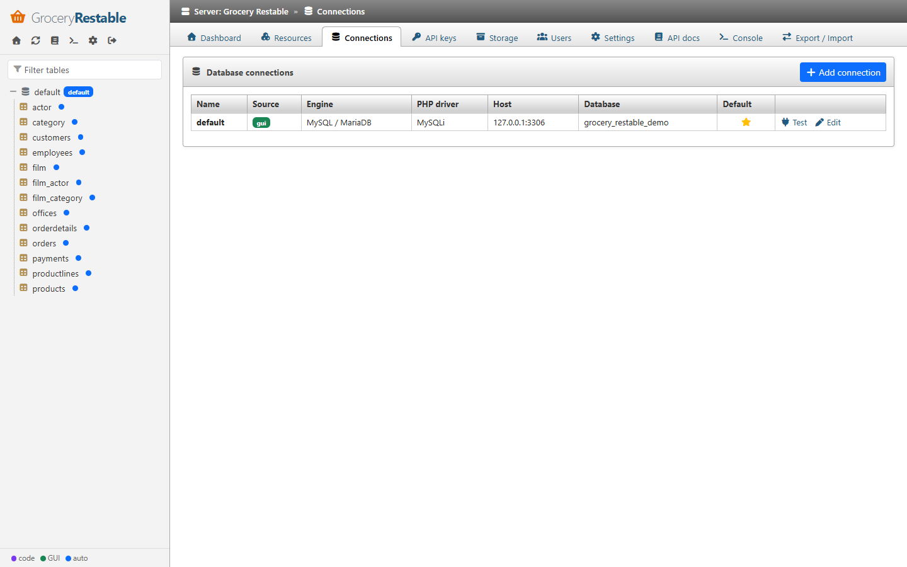

A connection has two independent choices:

- the **database engine** — the product that stores the data (MySQL / MariaDB, PostgreSQL, SQLite);
- the **PHP driver** — the PHP extension used to talk to it (PDO, MySQLi, or the CodeIgniter database layer).

PDO and MySQLi are *drivers*, not engines: PDO is one API with a sub-driver per engine (`pdo_mysql`,
`pdo_pgsql`, `pdo_sqlite`), while MySQLi only speaks MySQL / MariaDB. The GUI therefore asks for both and only
enables the drivers that are installed on the server.

## Supported combinations

| Engine | PDO | MySQLi | CodeIgniter 4 driver |
|---|---|---|---|
| MySQL 5.7+ / MariaDB 10.3+ | ✅ `pdo_mysql` | ✅ `mysqli` | ✅ `MySQLi` |
| PostgreSQL 11+ | ✅ `pdo_pgsql` | — | ✅ `Postgre` |
| SQLite 3.26+ | ✅ `pdo_sqlite` | — | ✅ `SQLite3` |
| Microsoft SQL Server | not supported yet | — | not supported yet (`SQLSRV`) |
| Oracle | not supported yet | — | not supported yet (`OCI8`) |

Status of the test suite: SQLite (PDO) and MySQL 8.4 (PDO, MySQLi and CodeIgniter MySQLi) are covered by
automated tests. The PostgreSQL code paths (introspection through `information_schema` / `pg_catalog`,
`ILIKE`, `RETURNING`) are implemented but were not run against a live server in this release — please
report issues.

### Which driver should I pick?

- **PDO** is the default and the recommended choice for every engine: one consistent API, real prepared
  statements (emulation is disabled for MySQL), native int/float results.
- **MySQLi** is an equivalent alternative for MySQL / MariaDB, useful on hosts where `pdo_mysql` is not
  installed. Queries are prepared statements as well and numeric columns are returned natively
  (`MYSQLI_OPT_INT_AND_FLOAT_NATIVE`).
- **CodeIgniter group** (CodeIgniter only) reuses `app/Config/Database.php`, so the API and your application
  share one configuration. Bindings are escaped by CodeIgniter.

There is no functional difference for the API between the drivers: the same SQL grammar, schema introspection
and error mapping are used for a given engine.

## Where connections come from

| Source | Defined in | Editable in the GUI |
|---|---|---|
| `framework` | CodeIgniter: `$databaseGroups` in `app/Config/GroceryRestable.php` | no (read-only) |
| `gui` | Setup wizard or **Connections** page, stored in SQLite (password encrypted) | yes |
| code | `$api->addConnection($name, fn () => new PdoConnection($pdo))` | no |

The **default connection** is used by auto expose and by resources without `setConnection()`. Change it on the
Connections page (star icon).



## Connection definition

Stored connections use this structure (also accepted by `ConnectionFactory::make()`):

```php
// MySQL / MariaDB with PDO
['driver' => 'mysql', 'client' => 'pdo', 'host' => '127.0.0.1', 'port' => 3306,
 'database' => 'shop', 'username' => 'api', 'password' => '…', 'charset' => 'utf8mb4']

// MySQL / MariaDB with MySQLi
['driver' => 'mysql', 'client' => 'mysqli', 'host' => 'db', 'database' => 'shop', 'username' => 'api', 'password' => '…']

// PostgreSQL
['driver' => 'pgsql', 'client' => 'pdo', 'host' => 'db', 'port' => 5432, 'database' => 'shop',
 'username' => 'api', 'password' => '…', 'schema' => 'public', 'sslmode' => 'require']

// SQLite
['driver' => 'sqlite', 'client' => 'pdo', 'database' => '/var/data/shop.sqlite']
```

`driver` is the engine (kept as `driver` for backward compatibility), `client` the PHP driver (default `pdo`).
Invalid combinations (e.g. PostgreSQL + MySQLi) and missing extensions are rejected with a clear message.

## Multiple databases

Add more connections in the GUI or in `$databaseGroups`, then bind resources to them:

```php
$api->resource('invoices')->setConnection('billing');
```

In the GUI, every connection appears in the navigation tree; the API resource tab of a table stores the
connection automatically. Relations always stay inside one connection.

## Schema cache

Table structures are introspected once and cached in SQLite. Every request runs one cheap **fingerprint** query
(MySQL: a checksum of `information_schema` columns and keys; PostgreSQL: an MD5 of the columns plus the key count;
SQLite: `PRAGMA schema_version`). When it changes — a table, column or key was added, renamed or altered — the schema
is introspected again immediately, so migrations are visible on the next request. `schema_cache_ttl` (default 300 s)
is only an upper bound. You can still force a refresh with the refresh icon in the navigation, **Settings → Clear
schema cache**, `php spark grocery-restable:cache` or `$api->schema()->refresh()`.

## Database user permissions

Grant the API database user only what the API needs (`SELECT`, `INSERT`, `UPDATE`, `DELETE` on the exposed
tables). Introspection reads `information_schema` (MySQL, PostgreSQL) / `sqlite_master` (SQLite), which every
user can read for the tables it has access to.
