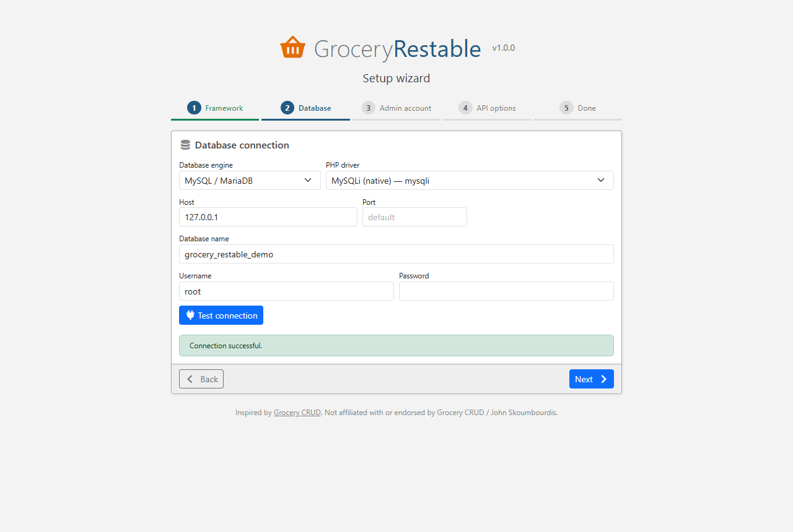

Grocery Restable's core has no framework dependency. A single front controller serves both the REST API and the
admin GUI, with native PHP sessions and its own database connection (PDO or MySQLi).

## Installation

```bash
composer require kctofficial/grocery-restable
```

Copy `vendor/kctofficial/grocery-restable/config/grocery-restable.php` into your project and adjust it:

```php
return [
    'framework' => 'standalone',
    'storagePath' => __DIR__ . '/../writable/grocery-restable',   // OUTSIDE the web root
    'apiUrl' => '/api',
    'adminUrl' => '/grocery-restable',
    'debug' => false,
    'encryptionKey' => getenv('GROCERY_RESTABLE_KEY') ?: '',
    'setupToken' => getenv('GROCERY_RESTABLE_SETUP_TOKEN') ?: '',
];
```

## Front controller

```php
<?php
// public/index.php
require __DIR__ . '/../vendor/autoload.php';

use GroceryRestable\GroceryRestable;
use GroceryRestable\Http\NativeServer;

$api = GroceryRestable::create(require __DIR__ . '/../config/grocery-restable.php');

// Optional: resources in code (take precedence over the GUI)
$api->resource('employees')
    ->setRelation('officeCode', 'offices', 'city')
    ->requiredFields('lastName');

if (! NativeServer::serve($api)) {
    http_response_code(404);   // not an /api or /grocery-restable URL: your own routing goes here
}
```

`NativeServer::serve()` dispatches requests whose path starts with the path of `apiUrl` or `adminUrl` and
returns `false` for everything else, so it can live next to an existing application.

Route every request to the front controller. Apache:

```apache
RewriteEngine On
RewriteCond %{REQUEST_FILENAME} !-f
RewriteRule ^ index.php [QSA,L]
# Pass the Authorization header to PHP (CGI/FastCGI)
RewriteRule .* - [E=HTTP_AUTHORIZATION:%{HTTP:Authorization}]
```

nginx:

```nginx
location / {
    try_files $uri /index.php$is_args$args;
}
```

Try it immediately with the bundled example:

```bash
php -S 127.0.0.1:8080 examples/standalone/index.php
# open http://127.0.0.1:8080/grocery-restable
```

## Setup

Open `/grocery-restable`: the wizard proposes **No framework (native PHP)** (CodeIgniter 4 is only selectable when the
library runs inside a CodeIgniter application). Step 2 asks for the database **engine** and the **PHP driver**,
e.g. *MySQL / MariaDB + MySQLi* or *PostgreSQL + PDO*. See [Database connections](database-connections.md).



## Lower level usage

When you have your own router, build a `GroceryRestable\Http\Request` and emit the `Response` yourself:

```php
use GroceryRestable\Http\NativeServer;

// in your /api/{path} route
$request = NativeServer::requestFromGlobals($path, 'https://example.com/api');
$api->handle($request)->send();

// in your /grocery-restable/{path} route
$api->handleAdmin(NativeServer::requestFromGlobals($path, 'https://example.com/grocery-restable'))->send();
```

Or construct the request explicitly (useful for PSR-7 bridges, tests, queues):

```php
use GroceryRestable\Http\Request;

$response = $api->handle(new Request(
    method: 'GET',
    path: 'employees',
    queryString: 'select=lastName&limit=5',
    headers: ['apikey' => $key],
    baseUrl: 'https://example.com/api',
));

$response->getStatus();       // 200
$response->getHeaders();      // ['Content-Type' => 'application/json; charset=utf-8', 'Content-Range' => '0-4/*', ...]
$response->decodedJson();     // array of rows
```

Serving a single resource Grocery CRUD style (path relative to the resource):

```php
$employees = (new \GroceryRestable\Resource\Resource('employees'))->setRelation('officeCode', 'offices', 'city');
$api->render($employees, NativeServer::requestFromGlobals($pathAfterResource, 'https://example.com/staff'))->send();
```

## Validation and sessions

- `setRules()` uses the built-in validator, which implements the common CodeIgniter rules
  ([Validation](validation.md)). Replace it with `$api->setValidator(new MyValidator())`.
- The admin GUI uses PHP native sessions (cookie `grocery_restable_admin`, `HttpOnly`, `SameSite=Lax`, `Secure`
  on HTTPS). Pass your own `SessionInterface` implementation to `handleAdmin()` to integrate another session store.
